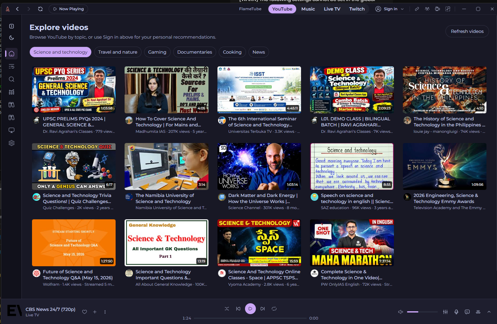
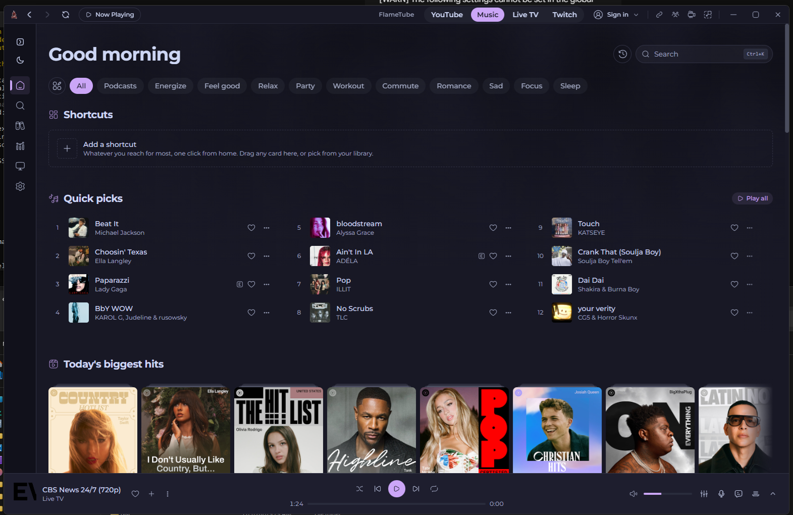
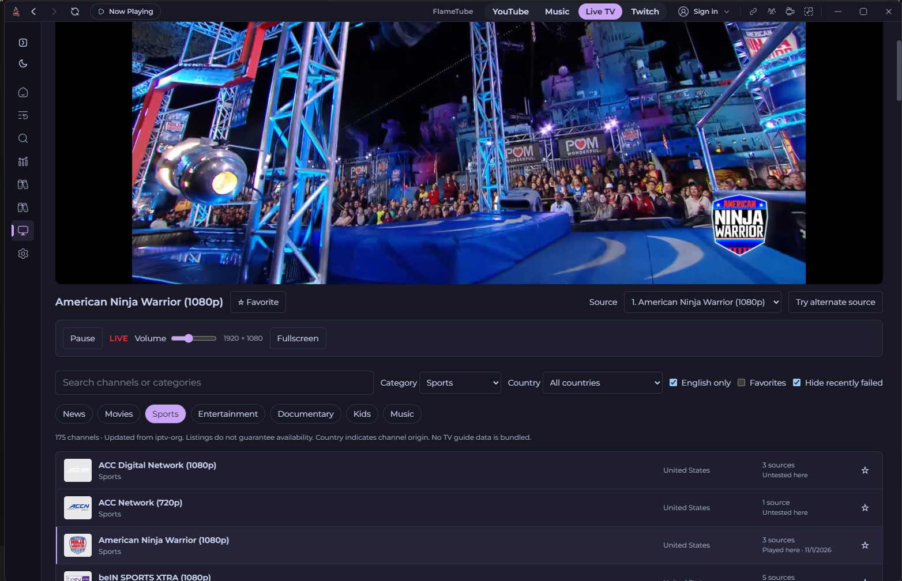
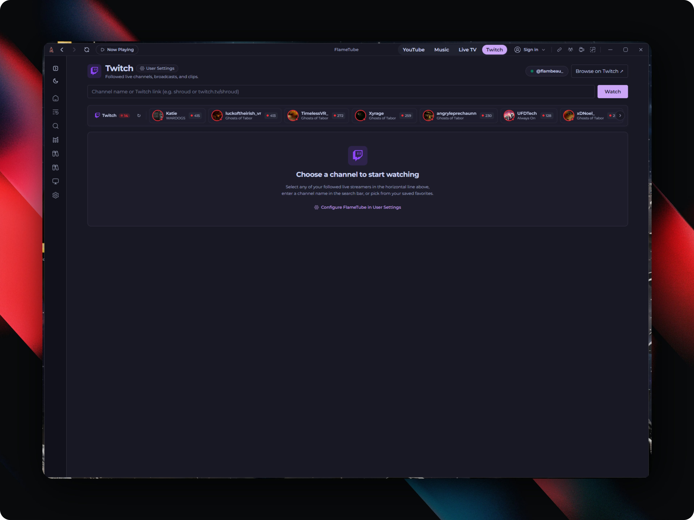
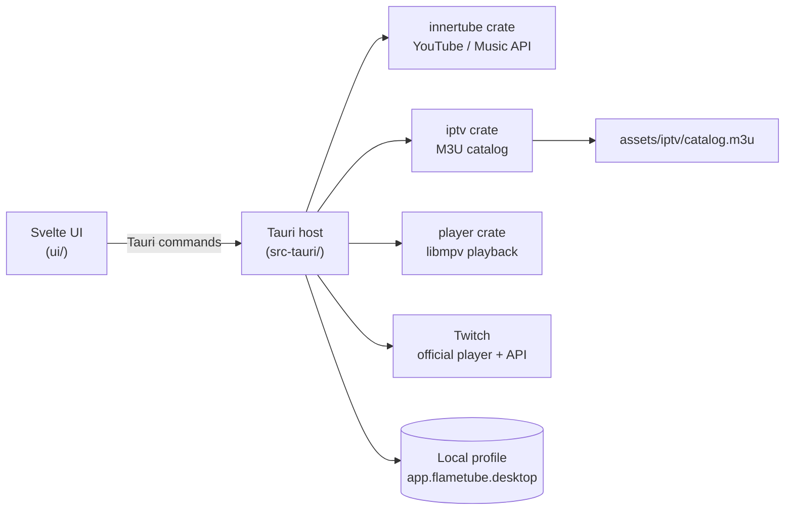

<p align="center">
  
</p>

<h1 align="center">FlameTube</h1>

<p align="center">
  <b>YouTube, YouTube Music, Live TV and Twitch in one native desktop app.</b><br>
  Built with Rust, Tauri, Svelte and libmpv.
</p>

<p align="center">
  <a href="LICENSE"></a>
  
  
  
  
</p>

---

FlameTube is a desktop player that puts four destinations behind one top bar:
**YouTube · Music · Live TV · Twitch**. Video plays through a native libmpv
player instead of a browser tab, and the **Now Playing** button always takes you
back to whatever is playing without restarting it.

It is a fork of [Limusic](https://github.com/SimoHypers/limusic) and starts
from a clean, source-only base: no accounts, cookies, history or databases ship
with it. Everything is created locally on first run.

## Contents

- [Screenshots](#screenshots)
- [Features](#features)
- [How it works](#how-it-works)
- [Install](#install)
- [Quick start](#quick-start)
- [Configuration](#configuration)
- [Build from source](#build-from-source)
- [Project structure](#project-structure)
- [Troubleshooting / FAQ](#troubleshooting--faq)
- [Contributing](#contributing)
- [License and credits](#license-and-credits)

## Screenshots

| YouTube | YouTube Music |
|:---:|:---:|
|  |  |
| **Live TV** | **Twitch** |
|  |  |

## Features

### 📺 YouTube
- Browse, search, subscriptions, playlists, watch history and Watch Later.
- Native libmpv video playback with accessible quality controls.
- Comments panel. Optional YouTube sign-in.

### 🎵 YouTube Music
- Home shelves, search, albums, artists, playlists, library and history.
- Lyrics and listening stats.

### 📡 Live TV
- Bundled channel directory from [iptv-org](https://github.com/iptv-org/iptv).
- Compact single-column channel list with English-language filtering and US-first sorting.
- Categories, search, favorites and alternate streams per channel.

### 🟣 Twitch
- Channels, past broadcasts and clips through Twitch's official player. No API key needed.
- Optional account connection (device code, your own Client ID) for followed live channels and broadcaster profiles.
- Local favorite channels.
- Chat with theme, size, docking, browser pop-out and Chatterino launch controls.
- Leaving Twitch unloads its player; Now Playing reopens the last channel.

### 🖥️ Desktop
- One top bar for every destination, plus **Now Playing**.
- System tray, global hotkeys, mini player and media-key integration.
- Command palette and appearance settings.

> Discord Rich Presence and Last.fm/ListenBrainz scrobbling code is inherited from
> Limusic but is **disabled** and hidden from settings.

<!-- TODO(flambeau): confirm which desktop extras (tray, hotkeys, mini player, Spotify import,
     Listen Together) are actually exposed in the FlameTube UI; source exists for all of them in src-tauri/src. -->

## How it works



- **UI** - SvelteKit, built as a static site and loaded by Tauri.
- **Host** - Rust Tauri app: commands, session, local database, proxies and native video window.
- **`crates/innertube`** - YouTube/YouTube Music client with a RustyPipe fallback.
- **`crates/player`** - libmpv wrapper for audio and video.
- **`crates/iptv`** - parser and model for the bundled Live TV catalog.
- **`crates/listen-protocol`, `crates/sync-server`** - inherited Limusic "Listen Together" protocol and self-hosted WebSocket hub.

## Install

### Windows x64

<!-- TODO(flambeau): publish FlameTube-Setup-0.2.0-x64.exe as a GitHub Release and link it here.
     The installer is not tracked in git, only its .sha256 file. -->

1. Get `FlameTube-Setup-0.2.0-x64.exe`.
2. Check it against [`FlameTube-Setup-0.2.0-x64.sha256`](FlameTube-Setup-0.2.0-x64.sha256):
   ```powershell
   Get-FileHash .\FlameTube-Setup-0.2.0-x64.exe -Algorithm SHA256
   # 77c2e324bd7d4acd4985b2e4c76395281d56ed62f8a3fb34458c9fb4e8f81cd1
   ```
3. Run it. The installer is **unsigned**, so if SmartScreen warns, click **More info**, then **Run anyway**.

WebView2 is required (already present on current Windows 10/11). libmpv is bundled.

## Quick start

1. Launch FlameTube. A fresh profile opens on **YouTube**.
2. Use the top bar to switch between **YouTube**, **Music**, **Live TV** and **Twitch**.
3. Start something, wander off, and hit **Now Playing** to get back to it.
4. Optional: sign in to YouTube, or connect Twitch (see below).

## Configuration

Everything is set in the app; there are no required environment variables or config files.

| Setting | Where | Notes |
|---|---|---|
| YouTube sign-in | In app | Optional. |
| Twitch Client ID | Twitch settings | Optional. Your own registered **public** Twitch app Client ID. No client secret. Enables followed channels and profiles. See [`docs/twitch.md`](docs/twitch.md). |
| Twitch chat login | Embedded chat | Separate from the API connection above. |
| Live TV favorites, filters | Live TV | Stored locally. |

Profile data lives under the app identifier `app.flametube.desktop`, separate from any Limusic profile.

<!-- TODO(flambeau): add the exact Windows profile folder path once confirmed. -->

## Build from source

### Requirements
- Rust (MSVC toolchain)
- Visual Studio 2022 Build Tools with **Desktop development with C++**
- Node.js 26, Git, 7-Zip
- WebView2 runtime

### Build

```powershell
.\scripts\setup-windows.ps1   # downloads pinned, SHA-256-verified libmpv and makes its MSVC import lib
.\scripts\build-windows.ps1   # installs UI deps, runs checks, builds the NSIS installer
```

The installer lands in `target/release/bundle/nsis`.

Development executable (no installer):

```powershell
.\scripts\build-windows.ps1 -Debug -NoBundle
# -> target/debug/limusic-app.exe  (internal crate name kept from Limusic)
```

### Tests and checks

```powershell
cd ui
npx --yes pnpm@10 install --frozen-lockfile
npx --yes pnpm@10 check    # svelte-check
npx --yes pnpm@10 test     # frontend self-checks
npx --yes pnpm@10 build

cd ..
cargo test -p flametube-iptv --locked
```

### Other platforms
Linux and macOS source is kept (there is a `flake.nix` and `tauri.macos.conf.json`), but
only Windows x64 is validated. Other platforms need the usual Tauri and libmpv dependencies.

### Refreshing the Live TV catalog
```powershell
node scripts/sync-iptv.mjs
```
Read [`docs/iptv.md`](docs/iptv.md) first.

### Updating the logo
See [`assets/branding/README.md`](assets/branding/README.md).

## Project structure

```text
FlameTube/
├─ ui/                      SvelteKit frontend
│  └─ src/
│     ├─ lib/components/    Titlebar (top bar, Now Playing) and shared UI
│     └─ routes/            video/ (YouTube), live/, twitch/, album/, artist/, playlist/, ...
├─ src-tauri/               Tauri desktop host and native playback adapter
├─ crates/
│  ├─ innertube/            YouTube / Music client
│  ├─ player/               libmpv player
│  ├─ iptv/                 Live TV catalog model and parser
│  ├─ listen-protocol/      Listen Together protocol (inherited)
│  └─ sync-server/          Listen Together WebSocket hub (inherited)
├─ assets/
│  ├─ branding/             Logo sources
│  └─ iptv/                 Bundled catalog, metadata, license and provenance
├─ scripts/                 setup-windows.ps1, build-windows.ps1, sync-iptv.mjs
└─ docs/                    iptv.md, twitch.md, releases/
```

## Troubleshooting / FAQ

**SmartScreen blocks the installer.** It is unsigned. Click **More info**, then **Run anyway**.

**The dev build is called `limusic-app.exe`.** That is expected; the internal crate name is kept from Limusic.

**Rust backend unit tests fail to start on Windows.** The test executable needs a Common
Controls v6 manifest. The packaged app gets its manifest from the normal Tauri build.

**A Live TV channel will not play.** Availability, codecs and geo-access vary. Try one of
the channel's alternate streams. FlameTube only lists directory entries; it hosts no content.

**Twitch followed channels are empty.** Connect a Twitch account with your own Client ID.
Signing in to chat is a separate session and does not enable the API features.

**Will it update itself?** No. Signed automatic updates are not configured yet.

## Contributing

Issues and pull requests are welcome. Please:

- Keep the top bar order: YouTube, Music, Live TV, Twitch.
- Run the UI checks and `cargo test -p flametube-iptv --locked` before opening a PR.
- Read `docs/iptv.md` / `docs/twitch.md` before touching those areas.
- Never commit profiles, cookies, tokens, keys, databases, recordings or binaries.
- Do not enable the dormant Discord or scrobbling services.

See [`AGENTS.md`](AGENTS.md) for the full development notes, and
[`docs/releases/0.2.0.md`](docs/releases/0.2.0.md) for the latest release notes.

## License and credits

FlameTube is licensed under **GPL-3.0-or-later** ([LICENSE](LICENSE)).

- Forked from [Limusic](https://github.com/SimoHypers/limusic) by SimoHypers. Original notices are kept.
- Live TV directory from [iptv-org](https://github.com/iptv-org/iptv); see `assets/iptv/LICENSE` and `assets/iptv/source.json`.
- Playback by [libmpv](https://mpv.io/); app shell by [Tauri](https://tauri.app/). Dependencies keep their own licenses.

FlameTube is an independent project and is not affiliated with or endorsed by YouTube, Google or Twitch.